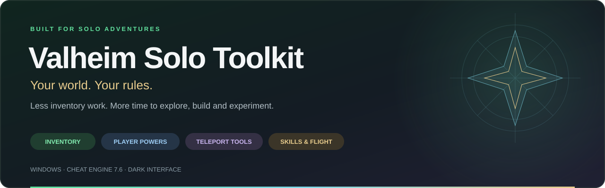

  

  A dark, easy-to-use Cheat Engine toolkit for Valheim server admins and solo players. 
  Manage your inventory, tune your skills and make the next adventure your own.

  <a href="Valheim%202026%20CT.CT"><strong>Download Valheim 2026 CT</strong></a>

  &nbsp; · &nbsp;
  <a href="#quick-start">Quick start</a>
  &nbsp; · &nbsp;
  <a href="#watch-it-in-action">Watch it in action</a>
  &nbsp; · &nbsp;
  <a href="#a-few-useful-details">Useful details</a>

 

## Quick start

**You need:** Windows, Cheat Engine 7.6 and Valheim running with Mono support.

1. Download **[Valheim 2026 CT.CT](Valheim%202026%20CT.CT)**. On GitHub's file page, use **Download raw file**.
2. Start Valheim and load your world.
3. Open the table in Cheat Engine and allow its Lua script to run.
4. The toolkit finds Valheim and loads your inventory automatically.

Not in your world yet? It quietly retries every **3 seconds** until the first load succeeds. There is no need to choose the process manually.

The **green Refresh inventory** button reloads your items whenever you need it. Hover over any action for a quick explanation, or open **Help & tips** for the full guide.

 

## Watch it in action

> 🎬 **YouTube walkthrough — coming soon**
> A tour of the interface, inventory tools and everything you can do in your world.

<!-- When the video is ready, replace the callout above with:

Replace both instances of VIDEO_ID with the actual YouTube video ID.
-->

 

## 🟢 Make inventory management effortless

Select an item, choose an action and get back to playing.

| Tool | What it does |
| :--- | :--- |
| **Edit quantity** | Set a stack to the amount you want, including above its normal limit. |
| **Clone an item** | Copy a selected item into your inventory. Leave an empty slot available. |
| **Max all stacks** | Fill existing stacks to their normal limits. Overstacks are reduced to those limits. |
| **Freeze quantities** | Hold one stack or all current stacks at their chosen quantities. An **X** shows what is frozen. |
| **Auto refill** | Ctrl + left-click a stack into an open chest. A copy transfers while the original stays in your slot. |
| **Delete items** | Enable the bottom-left in-game menu, drag a full stack from your inventory, then destroy and confirm. |
| **Item flags** | One **Clear all flags** toggle clears the entire inventory immediately and keeps carried-item flags clear while enabled. |

**Freeze selected** toggles the selected stack; **Freeze inventory** becomes **Unfreeze inventory** while any lock is active. Freezing captures the stacks you have now. New items and newly split stacks start unfrozen. Use **Auto refill** when you want to deposit an entire stack and keep the original.

 

## 🟡 Build freely. Carry more. Keep going.

| Player tool | What it does |
| :--- | :--- |
| **Fixed HP 999** | Holds local health at 999/999 with a normal food-based health bar. Food timers, stamina, eitr and hit effects continue normally. Turning it off restores normal saved HP, capped to the current food maximum. |
| **Unlimited resources** | Unlimited stamina, eitr and adrenaline, plus no ability health costs or summon-control cap, including Dead raiser. Works without eitr food. |
| **Fast attacks** | 10× melee attacks, bow/spell charge and projectile-spell burst timing; fast magic reloads; crossbows fire continuously while holding attack with instant rearming and 30× firing animations. Includes stamina and equipped weapon durability refill. Includes melee, magic weapons and pickaxes. |
| **Rapid hoe** | Hold use to repeat hoe terrain actions up to 20 times per second, with stamina refill and full hoe durability. |
| **Building tools** | Auto-build snapped rows, capture furnished blueprints, preview/rotate/paste saved structures, and undo the last paste. |
| **Enemy form** | Choose from 48 creature forms with native movement and attacks, including Drake and Moder with flight controls, and 0/1/2-star options. |
| **Free crafting** | Bypasses crafting and building material requirements. |
| **Unlimited carry** | Prevents encumbrance, even when you exceed the normal weight limit. |
| **Kameha** | The original cyan bow beam, with swirling particles, wind ribbons and bright impact effects. Targets hostile monsters. |
| **Death Beam** | Crimson/purple bow beam with up to 2km visual and damage reach across loaded objects, plus rapid surface-contact excavation. |
| **Spirit Bomb** | Huge blue-white sphere moving at 9m/s, with orbiting energy rings and an expanding 40m-radius blast. |
| **Supernova (Frieza)** | Giant orange/crimson sphere moving at 6m/s, with a 120m-radius explosion that damages loaded objects and excavates nearby ground. |

Click **DBZ Powers** and choose **1 Kameha**, **2 Death Beam**, **3 Spirit Bomb**, or **4 Supernova (Frieza)**. Equip a bow; hold Mouse 1 for beams or click to launch a bomb. Toggle off before changing powers. All powers replace ordinary bow shots and have local visuals. Kameha retains its original hostile-monster-only targeting and stops at terrain/buildings.

**Kayoken:** Enable a DBZ power, equip your bow, then check **Kayoken** beside the DBZ button. A pulsing red aura, rising red flames and red light surround your character. Kayoken applies **32× damage**, doubles beam width and bomb size/blast radius, and extends Kameha reach to **120m**. Death Beam retains its **2km** reach and dispatches **16,000 generic damage per 0.1-second tick**, plus chopping/pickaxe damage, excluding the caster. Native damage/PvP/protection rules still apply. Its excavation follows surface contact within the beam's width rather than slowly cycling pickaxe impacts.

Kayoken Spirit Bomb deals **160,000** generic damage with an **80m blast radius**; Supernova deals **640,000** with a **240m radius**, plus chopping/pickaxe damage. Damage and terrain still affect loaded objects/terrain and are processed in bounded batches. Bombs snapshot Kayoken at launch; unchecking changes beams and future launches, not a bomb already in flight. Unchecking removes the aura; disabling DBZ Powers, closing the toolkit or leaving the world resets the checkbox and cleans up effects. Aura visuals are local. Compilation, damage/terrain dispatch and checkbox lifecycle tests pass; live aura appearance and expanded blast performance remain unverified.

Bombs detonate on collision or after 20 seconds of flight. Spirit Bomb starts with a 12m core and deals 5,000 generic damage plus chopping/pickaxe damage; Supernova starts with an 18m core and deals 20,000. Their glow shells and orbiting rings extend beyond the core. Explosions expand over three seconds and fade over six. The caster is excluded from direct damage, but other creatures, pets and destructible objects are included, subject to native damage/PvP rules.

**Supernova spans 240m across**, within the loaded world around the impact. It does not destroy the whole map or force distant areas to load. Each destructible is hit once per blast, with damage and native pickaxe terrain impacts processed in batches. Large craters can take tens of seconds to finish; the toolkit status shows progress. One bomb can be active at a time. Toggle **OFF** or close the toolkit to cancel pending flight/blast work on the next game update; completed destruction remains. Death, teleporting or leaving the world also cancels it. Menus and loss of focus suspend processing. Native terrain depth and protected-area restrictions still apply; airborne explosions only dig ground inside the blast sphere.

The window title includes **DBZ Powers v2**. Disable the previous power and unpause before reloading. Compilation, selection/cleanup tests, damage dispatch and blast-layout tests pass; the new visuals, collisions and large-area performance still need live game verification.

Death Beam applies 500 generic damage plus chopping/pickaxe damage every 0.1 seconds to loaded destructible objects along its path, up to 2km. The caster is excluded, but pets, structures and other creatures are included; normal game damage rules, immunities and PvP rules still apply. Distant scenery without loaded game objects cannot receive damage. Multiple colliders on the same destructible receive one hit per tick.

**Death Beam excavates terrain permanently.** It saves bulk height edits only where the beam contacts the current surface, preserving existing edits on each tile. Valheim's heightmap creates open trenches, not enclosed underground tunnels, and normal terrain depth limits remain. Releasing stops new operations; already submitted edits remain. Terrain edits and damage affect the world even though the beam visuals are local. Compilation and automated damage/excavation tests pass; live visuals, terrain editing and multiplayer behavior still need an in-game check.

**Death Beam v2 excavation fix:** Ground impacts now use the iron pickaxe's registered terrain prefab through the game's normal pickaxe-impact routine. The previous temporary terrain object was discarded because this game version transmits only registered prefab names. Aim at or into the ground and hold fire; repeated sweeps dig down from the current surface. Normal pickaxe depth and area restrictions apply. Disable the old beam before reloading; this fix is included in **DBZ Powers v2**.

**v54 spell firing fix:** Fast attacks now speeds up the independent spell charge and projectile burst timers, and handles reloading magic staves alongside crossbows. Only the local player's live cast is changed; primary/secondary shared staff definitions stay intact. Stopping Fast attacks, changing weapons, opening menus, losing focus, death or teleporting restores live burst timing. Native projectile dispatch and per-burst resource use remain; Unlimited resources can bypass eitr costs. Compilation, charge/channel/reload/cost tests and lifecycle checks pass. Live firing feel and multiplayer still need verification.

**v53 summon control and layout:** Unlimited resources now bypasses the Dead raiser message that your staff is not strong enough to control more summons. It removes the per-cast spawn cap and weapon/skill-based instance cap only for the local player's casts. Per-cast level settings are copied before changing the caps; shared prefabs, staff quality, skeleton strength and other players/creatures keep their native settings. Turning the toggle off restores pending casts on the next game update; already spawned summons remain. Fast attacks and Trophy buffs now share the fifth Skills and movement row. Game-assembly compilation, summon policy/cleanup tests, Lua hook/lifecycle checks and layout checks pass; live summoning and multiplayer still need verification.

**v52 resource follow-up:** Keeps `GetAdrenaline` entirely native and removes the detour that called another getter from inside it. Unlimited adrenaline uses the actual refilled pool and blocks negative spending. This removes an extra native-call path after the reported session logged adrenaline/status-effect errors, widespread AI/player-list errors and a shutdown crash. Those logs do not prove a single root cause. Restart Valheim fully before testing v52; initially leave Fast attacks and Unlimited resources off, equip Dead raiser and check movement, then enable one feature at a time. Weapon quality and summon limits remain native; quality 1000 is not a guarantee of 1000 summons.

**v51 resource fix:** Removes the out-of-range memory operand behind the `comiss xmm1,[...]` assembly error. The adrenaline comparison now uses registers and preserves its scratch register. Resource hooks run Cheat Engine's syntax check before installation, and failed/partial installs restore the captured original code, with cleanup retries if needed. After encountering the v50 error, restart Valheim once and load v51 for a clean session. Automated assembly-generation and failure-recovery tests pass; live ability casting and walking still need verification. Unlimited resources leaves the weight check and encumbrance penalty in place; use Unlimited carry to remove encumbrance.

Enable **Unlimited resources** in the Player section (replaces Unlimited stamina). It bypasses stamina/eitr sufficiency checks and spending, supplies full adrenaline using your current equipment maximum, removes voluntary ability health costs, including blood magic, and bypasses summon-control limits for your own ability casts (including Dead raiser). Stamina, eitr and adrenaline refill every 100ms to their current food/equipment maxima; those maxima are not edited. Magic works even when your food gives zero eitr, although the native eitr bar can remain empty in that case. Incoming damage still applies normally; Fixed HP remains a separate toggle. Ammo, crafting/building materials and ability cooldowns are unchanged. Disable to restore normal costs; refilled pools remain. Death, leaving the world, closing the toolkit and reloading the table remove the resource hooks. Automated hook/signature, zero-eitr, dynamic-capacity, failure and cleanup tests pass; in-game ability casting and multiplayer still need verification. Reload **v54** to use this toggle.

Enable **Fast attacks** in **Skills and movement** and use your normal attack controls. It covers swords, knives, clubs, polearms, spears, axes, bows, crossbows, fist weapons, magic weapons and pickaxes. Melee/magic attack animations and bow/spell charge progress run at 10× speed. Projectile spells also use 10× shorter burst intervals on the current cast, covering held channels as well as ordinary shots. Reload-based magic staves rearm while attack is held, charging the remaining native reload eitr cost once; already-paid ready shots are retained on release. Use the spell's normal hold/release controls. Native game updates and frame rate limit the achieved cadence. Spell damage, projectile count and shared staff definitions are unchanged. **For crossbows, HOLD attack to machine-gun bolts:** Fast attacks cancels the reload wait and instantly rearms the equipped crossbow between native shots, with firing animations at 30× speed. Release to stop firing. Native aiming, projectiles and per-shot bolt consumption remain. The actual firing rate depends on game timing and frame rate. Bows still fire when released; arrows and bolts are still required. Enable Unlimited resources to also bypass ability stamina/eitr/health costs. Hit detection, damage, range and weapon tier requirements stay native. Stamina and equipped weapon durability refill. Switching to a nonweapon, death, teleporting, leaving the world or disabling restores normal animation speed; refilled resources remain. Disabling, releasing attack, opening menus, losing focus or switching weapons clears helper-loaded crossbow readiness; a shot loaded normally before enabling is preserved. Normal reloads return when Fast attacks is off. Compilation and automated behavior tests pass; crossbow firing cadence and multiplayer still need an in-game check. Disable the old toggles and reload the updated table (v54).

Enable **Rapid hoe** alongside Fast attacks, equip the hoe, choose its terrain action and hold the use button (mouse attack or controller place). Release to stop repeating. Normal terrain restrictions and material costs still apply, including stone for raising ground. Switching tools or disabling restores the original placement cooldown. Refilled stamina and durability remain. It can run alongside Fast attacks; each affects its own weapon or tool.

**Building v2** has its own row in the toolkit. Open **Building tools**, enable **Auto rows**, equip the hammer and select a straight floor, wall or horizontal beam. Start from a valid placement preview, hold **left mouse**, and aim along the row. Release **left mouse** to place it. Right-click or Escape cancels. Ctrl remains available for descending in flight mode. Tool/selection changes, menus and loss of focus cancel pending work. Already placed pieces remain.

The translucent previews use the piece's meshes and aligned snap points, lock to its horizontal X/Z axes, and cap each row at 24 pieces. Release to automatically build at those exact positions, four pieces per frame. Once the starting placement is valid, the row does not recheck line of sight, player reach, snapping, collision or hammer cooldown, so you can stay where you started. The preview is the placement plan: avoid running it through existing structures. Native piece creation retains creator/network setup, placement effects and structural support; unsupported pieces can still collapse. Direct row placement uses the game's cheat marking unless its bypass setting is active.

With **Free Crafting ON**, rows consume no materials, stamina or hammer durability. With it off, each piece checks the normal materials/station, stamina and hammer requirements and pays the normal costs; the row stops if these run out. World free-build material settings are respected. Drag build does not enable Free Crafting automatically. Irregular/sloped pieces and vertical stacking remain unsupported.

Drag build and Rapid Hoe share the game's placement callback, so enabling either turns the other off. The toolkit title includes **Building v2**. Compilation, row geometry and UI/hook lifecycle tests pass; live snapping, previews and placement still need an in-game check.

**Furnished blueprints (Building v2):** Stand inside the building at floor level, then open **Building tools → Capture furnished blueprint**. Enter a save name and box dimensions (width, height, depth; 2-80m each). Return to Valheim with your hammer once so the capture runs. The box is centered on your character's world position at that moment, starts **1m below your feet**, and extends upward. It captures loaded player-built pieces whose origins lie inside that box, up to 512 pieces. The selection and serialized snapshot stay fixed afterward: breathing, camera motion and later movement do not change the count. Re-capture with different dimensions or from a different standing position to adjust it.

When the status says **Captured N pieces**, click **Save captured blueprint** in the Building window. Saving reads the frozen data, so it works while Cheat Engine has focus and Valheim is paused. It verifies the written file and displays its full path. No F6/F7 sequence is needed for capture; F7 remains an optional save shortcut in game. Existing names get numbered suffixes instead of failing or overwriting earlier files. Cancel preview retains a ready capture for saving; another Capture/Load, disabling tools or leaving the world clears it. Files are stored under `%LOCALAPPDATA%\ValheimSoloToolkit\Blueprints`.

Choose **Load blueprint / preview**, enter a saved name, and return to the game. The preview follows the hammer placement ghost for anchoring/snapping, with an aimed-surface fallback. Q/E rotate in 15-degree steps, Page Up/Down adjust height by 0.5m, F6 locks/unlocks the preview, and F7 builds it. Saved pieces retain their relative positions and rotations. They are placed from lower to higher positions in batches without chasing or line-of-sight checks. Free Crafting skips materials, stamina and hammer wear. Otherwise the full material bill is checked before starting, each piece pays costs, and depleted stamina/durability or lost requirements stop the remaining work. Unsupported pieces may collapse, and overlaps are not prevented.

Blueprints include furniture, beds, containers, lights, crafting stations, decorations and sign text. Containers start empty, beds unclaimed, portals unlinked, and item/armor stands empty. Terrain, loose items, creatures, stored inventory, fuel state, displayed equipment and other object-specific settings are not copied. The tools reconstruct registered piece prefabs rather than duplicating world-object data. These direct placements retain the game's cheat marking unless its bypass setting is active.

**Undo last blueprint paste** removes only the exact network objects created by the most recent paste, including a partial paste. It does not delete the original building or other nearby pieces, and does not refund materials. Empty any pasted containers and remove newly displayed equipment before undoing them. Return to the pasted structure if a piece has left the loaded area. Cancelling previews preserves Undo; starting another paste replaces it. Disabling Building, switching to Auto rows/Rapid Hoe, closing the toolkit or changing worlds clears Undo history. Blueprint files remain in `%LOCALAPPDATA%\ValheimSoloToolkit\Blueprints` as `.vbp` files. Capture/load previews, placement, sign restoration and Undo are experimental and still need live game verification; compiler, persistence validation and mocked UI/lifecycle tests cover the offline checks.

**Enemy form** is under **Skills and movement**. Finish any attack or teleport, open **Enemy form...**, select a form and settings, click **Transform into selected form**, then return to Valheim and unpause. Your original player is hidden and suspended while you control a newly spawned enemy body. This is experimental; compilation and mocked tests pass, but live travel, camera, animations and multiplayer combat still need an in-game check. Form selection, setting changes, weapon cycling and returning never open Teleport tools.

**Flying forms (v9):** Drake is form 27 and Moder is form 28. Drake starts airborne; Moder starts grounded. Hold **Space** to climb (press it to take off as Moder), hold **Left Ctrl** to descend, and use the normal movement/run controls to fly. Press **G** near the ground to land as Moder. **Use** cycles attacks compatible with the current ground/air state; native takeoff/landing attack items are excluded in favor of the explicit flight controls. Flight speed follows the speed multiplier. The camera starts farther back and its previous settings are restored on return. **F8** restores your player on the ground below the creature when loaded terrain is available, otherwise at the last known ground return point. Choose open ground before transforming. Compilation and mocked flight/attack/camera/return checks pass; live flying, breath/projectile aim, collision and multiplayer replication need in-game verification.

**Turning fix (v5):** Forms face the movement direction while moving, and follow camera aim while idle or attacking. Facing updates no longer restart an unfinished look transition every frame. The game still applies each creature's native turn speed and attack restrictions. Return from any active form and unpause before reloading the updated table.

**Expanded roster (v6):** The original six choices keep their numbers. Added forms use the same turning controls, identity hiding and F8 return. Large creatures need open space; native area attacks can affect nearby objects. Added forms are experimental and still need in-game checks. Missing or incompatible prefabs cancel before suspending the player.

| Number | Form | Number | Form |
| :--- | :--- | :--- | :--- |
| 1 | Greydwarf | 14 | Blob |
| 2 | Skeleton | 15 | Oozer |
| 3 | Draugr | 16 | Surtling |
| 4 | Wolf | 17 | Fenring |
| 5 | Troll | 18 | Cultist |
| 6 | Sea Serpent | 19 | Fuling |
| 7 | Greyling | 20 | Fuling Berserker |
| 8 | Neck | 21 | Fuling Shaman |
| 9 | Greydwarf Brute | 22 | Lox |
| 10 | Greydwarf Shaman | 23 | Seeker Brood |
| 11 | Draugr Elite | 24 | Seeker Soldier |
| 12 | Draugr Archer | 25 | Abomination |
| 13 | Rancid Remains | 26 | Asksvin |
| 27 | Drake | 28 | Moder (dragon) |

**Sea Serpent** is option **6** in Enemy form. Transform in deep water with room for the body. Normal movement steers its native surface swimming, and Attack uses its native attack weapon. This transforms you at your current location; it does not teleport you to an existing serpent or automatically find the ocean. F8 returns your player at the serpent’s last position, including in water. Return to your player and unpause before loading the new table; the window title should show **Enemy form v8**. Sea Serpent still needs an in-game check.

The transformation waits for Valheim to initialize the enemy's native weapons before suspending your player, including built-in unarmed attacks. If no attack becomes available within three seconds of game time, it cancels and leaves your player unchanged. The V2 helper fixes the early “no usable native attack weapons” error; reload the updated table to load the new helper even in an existing game session.

**Enemy form v8** also hides your player nameplate and local map/minimap position markers, temporarily blanks the player's network display name, and turns off shared map position. Returning restores your original display name and map-sharing preference. Other players' markers and nameplates are unaffected. This does **not** guarantee that other clients see only the enemy model, and shared-map changes depend on normal network updates. Your account and saved character-profile name are not changed.

| Enemy-form control | Action |
| :--- | :--- |
| Normal movement, run and jump bindings | Use the enemy's native movement; keyboard and controller inputs are supported. |
| Attack | Use its currently equipped native attack weapon. |
| Secondary attack or Block | Use the weapon's secondary attack, or its primary if none exists. |
| Use / interact | Cycle the enemy's available native weapons. Different forms have different attack sets. |
| **F8** or **Return to player** in the popup | Restore your player at the current position, or the original transformation point when its option is checked. Flying forms use a ground return. |

**Speed and jump modifiers also work while transformed (v8).** Use the existing **Movement speed**, **Jump force**, and **Reset speed and jump** controls. Settings chosen before transforming carry over, and changes apply on the next game update while transformed. Each creature scales its own native walk/run/crouch/swim speeds and jump force; values do not compound when changing settings or forms. Reset restores the current creature's native values. Creatures with no native jump retain that limitation. Returning to your player keeps your selected player modifiers.

The popup has independent settings, which also apply while transformed:

- **Red monster allegiance** unchecked keeps the green/player faction behavior. Checked restores the creature's native faction for its red hostile nameplate and excludes your form from local creature AI target searches. AI controlled by another client still follows that creature's native faction relationships; rival monster factions can remain hostile there. This table does not synchronize custom faction/AI flags to unmodified clients.
- **Monster duel / friendly hits** enables native melee, secondary and projectile hits against allies, including two identical monster forms. Both duelists transform and enable the option. Creature attackers use the game's creature damage path, so neither player's PvP switch needs changing. Red/native monster attacks against ordinary players already follow creature damage rules even with duel mode off. Friendly hits can also damage nearby players or pets. Turning duel mode off restores native attack flags, including for tracked projectiles still in flight. Only your spawned body's attack data and its projectiles are changed.

**Movement streaming:** v7 explicitly updates the world loading position from the controlled monster, replacing the suspended player's normal `LateUpdate` update. New terrain and network objects can load as you travel beyond the transformation area; normal game streaming delays still apply.

The enemy body uses its own health. Its death returns you to your original player. Inventory, skills and original health stay with your player; the ordinary HUD still represents that player, so check the toolkit status for enemy health and the selected weapon. Menus or lost game focus stop movement and new attacks. Normal building and interaction controls are unavailable while transformed.

Returning restores the original camera anchor, visibility, collision and controls, and removes the spawned body. Closing the toolkit also queues restoration: **return to Valheim and unpause for cleanup to finish**. Choose another form by returning first, unpausing for restoration, then selecting the next form in the popup.

> [!IMPORTANT]
> **Free crafting can affect item flags.**
> Crafted or upgraded items can receive the flag when using Free crafting.
> Select the affected item and use **Item flags → Clear selected flag**, then **drop it and pick it up again**. Use the normal drop action, not Inventory delete.
> **Keep item flags off** continuously clears flags on carried items.

 

## 🔵 Choose your skills. Change how you move.

**Set custom skill level** opens a dedicated skill window. See current levels, check individual skills—or **Select all**—enter a level and click **Apply level**.

- **Max skills to 100** brings all existing skill entries to the normal maximum.
- **Custom levels** let you go above 100. Unchecked skills stay unchanged.
- **Movement speed** adjusts how fast you walk, run, crouch and swim.
- **Jump force** gives your jumps more height.
- **Flight** lets you rise with **Space**, descend with **Left Ctrl** and move faster with **Shift**.
- **Reset speed and jump** restores the original movement values.

Changing a skill level resets that skill's progress toward the next level. Higher-than-normal levels may still be limited by the game's own calculations. Flight does not disable collisions.

 

## 🟣 Turn your map into a travel menu

Open **Teleport tools** to choose where you want to go next.

| Destination | How to use it |
| :--- | :--- |
| **Map marker** | Create a named marker on Valheim's map. Click **Refresh locations**, select it and **Teleport selected**. |
| **Map ping** | Ping a location in the game, then refresh while the ping is visible. Select its **Ping** row and teleport. |
| **Saved location** | Stand still and click **Save current position**. Name the spot and return whenever you like. |
| **Coordinates** | Enter **X Y Z**. **Y** is height. |
| **Another player** | They must enable **Visible to other players** on their map. Click **Refresh players**, select them and teleport. |
| **Last death** | Teleport to your character's last recorded death in the current world, even after retrieving or moving the tombstone. |
| **Teleport to tombstone** | Teleport beside your latest remaining tombstone, matched by character ID. |
| **Bring tombstone to me** | Move your latest known tombstone beside you with its inventory intact. Stand on open, solid ground. |

Saved locations are local bookmarks for each world; they do not create markers on the in-game map. Map and ping destinations use the coordinates captured when you refresh. Player destinations use the latest shared position when clicked, with a small sideways offset.

Select any destination and click **Favorite**. Favorited locations and players move to the top with gold text and a star marker; the button changes to **Unfavorite** for the selected favorite. Favorites persist per world in Cheat Engine settings. Player favorites follow their names as they move; players still need to share their position to appear. Refreshing preserves your selection when the destination remains available.

Return to the game and unpause after queuing a teleport. Give the destination time to load. **Cancel queued** cancels a waiting request; it does not undo an accepted teleport.

Tombstone recovery moves the existing object and its spawn point; it does not duplicate items or target another character's tombstone. The original death location remains unchanged. An open tombstone cannot be retrieved. Remote clients may not know distant tombstone locations: use **Last death** in that case. **Bring tombstone to me** has no host-only gate, but the client must know the tombstone and successfully synchronize its networked position. Searches run in batches while the game is unpaused.

After dying, finish respawning and wait until you can move, then click the recovery action. Requests queued before death are cancelled; clicking again uses your new player object. Recovery v2 fixes the player-reference argument that could falsely report a player/world change after respawn.

 

## What's new in v37

Enemy form v9 adds Drake and Moder, bringing the list to 28 forms. Includes native flight controls, near-ground landing for Moder, flight speed scaling, ground/air attack selection, a wider camera and ground return when leaving a flying form. The previous 26 forms remain available.

## What's new in v36

Fixed HP 999 replaces God Mode, preserves normal saved health and food behavior, and keeps the health bar at its normal food-based size. The toggle uses the normal border. Hooks no longer request nearby allocations, removing the allocation warning. Styled buttons redraw after returning from the game and avoid repeated reparenting.

## What's new in v35

Movement speed and jump force now apply to transformed creatures, including settings selected beforehand, live changes and Reset. Enemy form v8 scales each creature's own native values without compounding, and leaves the teleport popup closed.

## What's new in v34

Enemy form now has a dedicated 26-form popup, live green/red allegiance and monster duel settings, and a loading-position fix for travel beyond the transformation area. Duel attacks cover native melee, secondary attacks and ranged projectiles without changing player PvP settings. Enemy menu actions do not open Teleport tools. Reload the table and confirm **Enemy form v8**; return to your player and unpause before replacing an older active transformation.

## What's new in v33

- **Teleport favorites:** Favorite or unfavorite locations and shared players with one button. Favorites appear first in gold, persist per world, and keep your selection when the list reorders.
- **Freeze inventory + replenish fix:** Replenishing now uses the loaded helper directly, fixing the helper-unavailable error. Release packaging checks helper versions and method signatures automatically.

## Valheim 2026 CT: admin and solo tools

### Clear weather

Use **Player → Clear weather** to force the local Clear environment, remove ordinary fog, and hide loaded Mistlands mist particles. The button turns green while active. Turn it off or close the toolkit to restore the previous environment override, fog settings and mist renderer visibility. Leaving the world, changing player or dying also ends the effect. Server-wide weather and time of day are not changed. The Kayoken checkbox and its help section have been removed.

Compilation and queued-action checks pass; rain transitions and Mistlands visibility/restoration still need in-game testing.

### Auto harvest and Loot magnet

**Auto harvest ready crops** lives in the Auto planter window. It harvests ripe pickables from registered cultivator-grown crop prefabs on cultivated ground within 20 metres. Normal growth timers are unchanged. Native harvesting produces normal drops and effects; matching new harvest drops fly toward your inventory. Closing the farming window stops planting and harvesting.

Open **Inventory → Loot magnet...** for separate **Cheated items only** and **All loot drops** toggles. Only one magnet mode runs at a time. Set a radius from 5 to 500 metres (default 100), activate a mode, return to Valheim and unpause. Loaded loose drops fly toward you and use native inventory pickup. Cheated flags remain unchanged. Placed items, tar-stuck loot, protected drops and stacks that cannot fit remain in the world. Network ownership requests can delay collection, and unloaded drops cannot be attracted.

Stop or close the magnet window to stop its mode; auto harvest remains independently controlled. Closing the toolkit, dying, teleporting or changing worlds stops both. Compilation, filtering and queued-action checks pass; live harvest yields and multiplayer pickup still need testing.

### Auto planter

Open **Building → Auto planter...**, select a cultivator plant, equip your cultivator and stand on cultivated soil. Click **Start planting**, return to Valheim and unpause. It scans the connected cultivated patch within 20 metres of your starting point, placing up to 256 plants with spacing based on the plant's growth radius. Occupied spots, incompatible biomes, roofs and protected areas are skipped. Normal planting materials are consumed unless free crafting is enabled.

Use **Stop planting** to cancel; existing crops remain. Closing the planter window, unequipping the cultivator, moving more than 25 metres away, dying, teleporting or changing worlds stops planting. Compilation and packaged Lua checks pass; in-game growth, spacing and multiplayer behavior still need testing.

### Set selected item quality

Select equipment in the Inventory list and click **Selected item → Set quality...**. Enter a whole quality level from 1 to 1000; the prompt shows the current quality and the ordinary upgrade cap. Higher refinement levels are allowed. Return to Valheim and unpause to apply the change. The same carried item and stack are retained, durability wear percentage is preserved, and equipped status effects are refreshed. Inventory changes while entering the quality cancel the request.

Set quality uses the standard gray action-button styling. It does not set `m_cheated` and leaves an existing cheated flag unchanged. Compilation, chosen-quality/flag preservation and stale-item/rollback checks pass; the user confirmed this action does not trigger the cheated flag in-game.

Download **[Valheim 2026 CT.CT](Valheim%202026%20CT.CT)** for the current toolkit. It is self-contained and includes the features below.

### Custom teleport

Our custom Teleport tools call the game teleport method directly and bypass carried-item teleport restrictions. Items and their icons remain unchanged. The separate item-permission toggle has been removed. Remove cheated item flags remains a separate inventory action. Reload Valheim 2026 CT.CT and confirm Valheim 2026 CT | v37; the previous icon override is stopped and restored during reload.

The toolkit uses consistent rectangular buttons with thin outlines. Toggle fills turn green when active and gray when inactive; action buttons stay gray. Yellow outlines identify cheated-alert risks for Flight and Free crafting regardless of their active state. Fixed HP 999 uses the normal border. ON/OFF text is omitted from the visible buttons. Hover or open Help for the meaning and feature-specific details.

### Freeze inventory + replenish

Reload **Valheim 2026 CT.CT** and confirm **Valheim 2026 CT | v37** in the title. In Inventory, **Freeze inventory + replenish** replaces the separate Freeze inventory and Auto refill buttons. Enabling freezes current stacks and retains their source items when dropping on the ground or transferring into another inventory. Both Ctrl-click and drag deposits, including partial stacks, use a copy in a temporary source inventory so the normal destination transfer rules still apply. A full destination does not remove your original stack. Ground drops create the requested quantity without consuming the source; quest-item drop restrictions remain native.

Turning the button off or closing the toolkit disables both effects. New stacks start unfrozen; toggle off/on to include them. If enabling either effect fails, both are stopped. This covers player-inventory transfers and ground drops; it does not intercept machine-feeding, crafting or other generic item consumption. Compilation, Lua syntax and mocked deposit/drop checks pass; the new hooks still need an in-game check with full/partial ground drops and Ctrl-click/drag chest deposits.

### Pixie boats

In the toolkit, **Pixie boat...** is in **Skills and movement**, beside **Rapid tools**. **Rapid tools** enables **Fast attacks** plus rapid hoe and cultivator actions together. **Fast attacks** also has its own visible toggle for combat without enabling terrain tools. Cultivation and planting receive rapid actions, stamina protection and tool durability refill; normal seed/material costs and placement rules apply. If either helper stops or fails to enable, the combined toggle turns both off. Turning Fast attacks off also stops an active Rapid tools combination. Building mode remains incompatible with Rapid hoe and therefore turns off Rapid tools.

Reload **Valheim 2026 CT.CT** and confirm **Valheim 2026 CT | v44** in the title. Click **Pixie boat... → Toggle Pixie boat**, return to Valheim and unpause, then take the helm. **W/S** keeps the normal boat throttle steps, **A/D** steers, each tap of **Left Ctrl** gives one high jump with no cooldown, and **Shift** boosts speed. Holding the key does not repeat jumps. Rapid taps and repeat jumps in the air are allowed. Forward speed targets 25 m/s, or 40 m/s with boost; throttle steps scale that speed and reverse is slower.

Land driving adds spring lift above terrain and keeps the hull upright. Rocks and buildings still collide with the boat; steep cliffs are not automatically climbed. While driving, native propulsion/horizontal damping and water-impact/upside-down damage settings are temporarily overridden. Native vertical water damping, buoyancy, gravity and normal collision physics remain active. Land lift only runs above dry terrain, never against the submerged seabed, and is suspended during a jump. Leaving the helm, losing ownership, or opening menus restores the boat settings. Stop/close the boat window or close the toolkit to disable the mode; return to the game and unpause for restoration to execute. Changing player/world also ends it.

Only the locally controlled, normally network-owned boat receives the effect. There is no host-only restriction and ownership is not forcibly taken from another player. Boat physics compiles against installed Valheim assemblies; activation, one-shot queueing and cancellation have mocked tests. Speed, jumping, land handling, passengers and shared-server replication still require an in-game check.

### Taming tools

Open **Building row → Taming...**. Choose **0 stars (normal)**, **1 star**, or **2 stars** beside the spawn dropdown before spawning. Its spawn dropdown lists every registered creature with native Tameable support, including compatible modded creatures. Refresh the spawn list and unpause once to populate it; newly spawned creatures keep their native default tame state, so wheel-click tame them if needed. **Refresh + show on map** scans known network records for tamed creatures, lists their custom names (or species name when unnamed), and adds temporary map markers. Markers update while Taming mode is active. **Bring selected to me** moves the existing animal beside you, preserves its identity/name, updates its home point, and clears an old patrol destination. Stand on open ground with enough space for the animal.

Click **Enable wheel taming**, return to Valheim and unpause, then aim at a live creature within 10m and **click the mouse wheel in game**. Looking alone never tames it. Wheel-click taming uses the native taming method and shows in-game feedback; creatures without native taming support are rejected. Menus, chat and focus loss block the key. Closing the Taming window leaves wheel-click taming active; **Stop / hide markers**, leaving the world, or closing the toolkit disables it and removes only the toolkit's temporary markers when the game next updates.

Connected clients can only list world records synchronized to them; distant animals never seen by the client may be absent. Hosts generally have more complete world data. There is no admin/host gate, but animal ownership and server synchronization still matter. Compilation and mocked scanning, name preservation, movement, taming and cleanup checks pass; shared-server behavior still needs in-game testing.

### Pixie boat restored - new in v47

Removed experimental furniture mode because passengers without the toolkit could not reliably follow the moving furniture. **Pixie boat...** is boat-only again: take the helm, use **W/S** for throttle, **A/D** to steer, **Shift** to boost and tap **Left Ctrl** for a high jump. **No durability loss** remains on by default. Stop restores normal boat behavior. Native boat seats carry passengers without their needing the cheat table.

Stop active tools and return to Valheim to finish restoration before reloading. If furniture flight was active in an older table, land and stop it there first. Confirm **v47** in the updated window title. The restored boat build and automated checks pass; shared-server handling still needs an in-game check.

### Pixie boat durability - new in v44

**No durability loss** is checked by default in **Pixie boat...**. A scoped native damage guard now prevents health loss on the active, locally owned boat, including damage that bypassed the previous water-impact/capsize settings. This preserves the boat's current health without repairing it or protecting other boats and buildings. You can change the checkbox while the tool is running. Protection remains while opening the inventory or riding aboard your current boat; normal helm ownership is required. It stops when you leave the boat, stop the tool, close the menu/toolkit, die, teleport or change worlds.

The existing motor, land support, one-jump-per-Ctrl-tap and boost controls remain. Stopping restores the saved physics and damage settings. Return to Valheim and unpause once after stopping, then reload the updated table and confirm **v44**.

Compilation against the installed Valheim assemblies and automated C#/Lua tests pass for protection defaults, native damage/wear interception, current-health preservation, live options, other-object isolation, original controls, ownership changes, menu/queue cleanup and exact physics restoration. Live durability and multiplayer checks remain necessary.

### Chest network access fix - new in v43

Sorting previously skipped every destination owned by another client or the server, even if you could open it normally and its saved item filters appeared in the list. **SORT ITEMS** now requests the same owner-approved chest handoff as opening with **E**, waits for the response and local ownership, then loads the current inventory before moving items. Destination windows stay closed. Existing saved assignments, the shared route and nearest-first overflow remain compatible.

The button shows **REQUESTING CHEST ACCESS...** while waiting. Keep the game unpaused and the sorting panel open until it finishes. Closing the panel, disabling sorting or changing worlds cancels pending transfers. Busy and protected chests still remain untouched. Skipped counts now distinguish busy chests, protected chests and missing network access, and only count destinations matching items in the sorting chest. Denied and timed-out requests are reported separately. If a request times out, open the unavailable chest with E and try sorting again. Saved IDs still do not load distant terrain or chests.

Production compilation and automated tests cover remote ownership grants, delayed ownership/data, fresh inventory loading, overflow, item conservation, denied access, remote in-use flags, wards, timeouts, late replies, cancellation and restoring native chest callbacks. Live multiplayer verification is still needed. Disable active tools, unpause once, reload the table and confirm **v43** in the title. Re-enable Chest sorting; no reassignment is required.

### Safer monster transformations - new in v42

The hidden player now has scoped damage and death protection while transformed and during the return teleport/landing. The player's fall-height tracker and Rigidbody position follow the monster, preventing an old high-altitude position from causing lethal fall damage after distant travel and F8. Monster defeat restores the original player with their saved health and inventory, without creating a player tombstone through the normal damage/death paths.

Three safety checkboxes are in **Enemy form...** and can be changed while transformed:

- **Immortal monster** (off by default) protects only your controlled monster from damage and zero-health death.
- **Return to start on monster defeat** (on by default) returns your player to where the transformation began when the monster dies.
- **F8 returns to transformation point** (off by default) also returns you to the starting point when you manually revert. Otherwise you return at your current position; flying forms retain their safe ground return.

Origin returns use Valheim's native teleport so distant terrain can load before arrival. Unpause and let the return finish before transforming again or reloading the table. The player protection remains through loading and a brief landing period, then turns off. If the game declines the teleport for ten seconds, the player stays at the current position. Protection and origin teleport do not carry into another world. Existing tombstones are unaffected.

The helper compiles against the installed Valheim assemblies. Automated checks cover lethal damage, zero-health death, distant F8/fall state, inventory preservation, monster immortality, both return destinations, teleport cooldown/loading/timeout, world changes and deferred hook cleanup. Live death, travel and multiplayer behavior still need an in-game check. Reload the table after returning safely and confirm **v42** in the title.

### Chest sorting — new in v41

**v60:** Removed ghost storage and remote-deposit controls. Chest sorting keeps the opaque panel, larger text and one-click **Reassign all items + save** action. F9 opens setup only when aiming at a nearby chest. Reload the table and confirm **v60**.

**v59 readability update:** Chest sorting uses an opaque dark panel with larger text, a gold primary action, grouped setup buttons, a separate status area and bottom navigation. Panels scale to fit the display; long item names wrap and long status messages scroll. Custom styling restores the game's GUI state when drawing finishes. Compilation, button placement at 600p/720p/1080p/4K and existing storage checks pass. The code-rendered layout preview was reviewed; the final appearance still needs an in-game check. Reload the table and confirm **v59**.

**v58:** The storage menu now combines unassign, select all and save into **Reassign all items + save**. Reload the table and confirm **v58**. Compilation and automated replacement, persistence and UI checks pass; the changed menu still needs an in-game check.

Enable **Chest sorting** in the toolkit's Building row. The button turns **green** while active and shows **STARTING** until Valheim processes the request. Keep the game unpaused when enabling tools.

1. Open a chest normally with **E**, then click **Chest sorting** beside its Take All / Stack All actions. Choose **Make this a sorting chest** to create a drop-off chest for mixed items.
2. Put sample items in a destination chest, open its **Chest sorting** panel, click **Reassign all items + save**. It replaces old item filters with all eligible types currently in the chest and saves immediately. Duplicate stacks count as one type; equipped and quest items are skipped.
3. Put mixed items in any master sorting chest and click **SORT ITEMS**. All master chests in the current world share the same destinations. Matching chests provide nearest-first overflow; unmatched items and anything without room remain in the sorting chest.

Use **Back to chest** to return to normal storage and continue with the next chest. Sorting stays enabled. **F9** remains available as a shortcut. Assignments save with the world, including existing single-item and multi-item assignments. Adjust a destination chest's contents and click **Reassign all items + save** to rebuild its filters. An empty chest clears its old filters. Chest contents are preserved. **Remove sorting role** remains available for sorting source chests.

There is **no toolkit sorting distance cap**. Destinations must still be loaded, accessible and not in use by someone else. Since v43, remote destinations request the normal owner-approved network handoff before transfer. Saved IDs do not force distant chests to load. Click **SORT ITEMS** again after unavailable destinations become loaded. Existing destinations saved under different masters automatically join the shared route; no reassignment is needed.

The update also fixes the clipped sorting button, active-button color, cursor capture, open-chest assignment and quick-toggle behavior. Native inventory input is temporarily blocked while selecting filters, then restored on return. Dragging an item disables the setup button. Stopping sorting restores the original chest-button layout and preserves saved assignments.

Production compilation and automated tests pass for shared routing, multiple masters, item filters, quantity conservation, overflow, access/ownership, the native chest interface, cursor cleanup, toggle colors and button layout. The latest native UI and multiplayer behavior still need live game verification. Disable active tools, let Valheim update once, reload the table and confirm **v41** in the window title.

### Enemy forms and catalogue fixes — new in v40

Enemy form now offers **48 forms**, including six additional bosses, four Charred enemies, four Dvergr variants, Stone Golem, Seeker, Tick, Morgen, Growth and Lava Blob. Choose **0, 1 or 2 stars** before transforming, then return to Valheim and unpause. Drake and Moder retain their flight controls; the new ground forms do not inherit them. Bosses need open space. Native star visuals vary by creature.

Fixed a shared catalogue bug that could leave Spawn box dropdowns empty after using Taming. Each window tracks its own displayed list, and empty or failed refreshes preserve valid lists. Spawn box and Taming retain their **0-, 1- and 2-star** options.

Refresh requests need a game update to run: tab back into Valheim and press **Esc** if needed to close the pause menu. Returning focus alone can leave the game paused. Return to your player and disable active tools before reloading.

All 20 added prefab names were checked against the installed game and the [Jötunn character catalogue](https://valheim-modding.github.io/Jotunn/data/prefabs/character-list.html). Compilation and mocked control, cleanup and star-level tests pass for all 48 forms; actual attacks, appearance and multiplayer still need live verification.

### Categorized spawning

**Spawn box...** lets you choose **0 stars (normal)**, **1 star**, or **2 stars** for monsters/creatures, including tameable animals. Choose the stars before clicking **Spawn selected**. Merchants and resources use their normal defaults. The current table title includes **Valheim 2026 CT | v45**. The helper compiles against the installed game, and C# behavior tests and Lua checks pass for star levels, both selectors, request signatures and cancellation. Live appearance and multiplayer persistence still need in-game verification.

**Spawn box...** has separate **Monsters / creatures**, **Merchants**, and **Items / resources** dropdowns. The catalogue is generated from registered prefabs in your loaded game rather than a fixed monster list. Open it and unpause Valheim once to fill the lists, or use **Refresh spawn catalogue** after changes. Creatures include bosses, wildlife and other registered characters; players are excluded. Items/resources include all valid network-registered item drops, including equipment, ammunition, valuables, materials, food and trophies, plus harvest nodes, plants/bushes and ore rocks. Items show their localized in-game name with the internal prefab name in brackets when different (for example, **Bloodgold [Gold]** when registered). Selection follows the prefab across refreshes, and spawning uses that original prefab name. Merchants retain normal shop/progression rules. Creatures/merchants spawn beside you on clear ground; items/resources spawn at your feet. Results remain in Spawn box. Reload **v55** for the expanded catalogue; compilation, catalogue inclusion, localized-name spawning and refresh-selection tests pass. Live item availability depends on your loaded game.

### Trophy buffs and merchants

Open **Skills and movement → Trophy buffs...** to activate Eikthyr, The Elder, Bonemass, Moder, Yagluth, The Queen, Fader/Ashlands, or the Deep North power available in your game. **Activate all** applies all available trophy powers together. Activation automatically shares the buffs with players within **10 metres**, using native status-effect requests; friends do not need the toolkit. Trophy powers keep their native durations. **Remove trophy buffs** removes only your own trophy powers and leaves Rested, food and other effects alone. Return to Valheim and unpause to process actions.

**v56 Rested:** **Activate selected** and **Activate all** also refresh your Rested to the maximum comfort duration calculated from registered building-tool piece tables: shelter, the best piece in each comfort group, and unique ungrouped comfort pieces. You do not need those furnishings nearby. Only your live Rested instance is extended; longer existing buffs and shared effect definitions are preserved. Nearby players receive one native Rested refresh each, using their own comfort calculation, even without the toolkit. Maximum duration for remote vanilla clients is not guaranteed. This applies to the toolkit activation buttons; ordinary in-game forsaken-power activation is unchanged. Game-assembly compilation and automated comfort, refresh, sharing and removal tests pass; live dedicated-server behaviour still needs testing. Reload the table and confirm **v56** in the title.

**Spawn box...** now includes **Haldor, Hildir and Bog Witch**, alongside blueberry, raspberry, cloudberry and lingonberry bushes, Ashlands/green berry vines, and decorative normal/Deep North bushes. Vines need suitable support; missing prefabs are reported without spawning a substitute. Merchants appear beside you on clear ground, use their native registered prefabs, and keep normal shop/progression requirements. Spawns remain in the world. Merchant and nearby-player buff behavior still needs in-game confirmation; compilation and mocked tests pass.

### Summon a player

Reload **Valheim 2026 CT.CT** and confirm the title says **Valheim 2026 CT | v33**. Open **Teleport tools**, click **Refresh players**, select a **Player** row, then click **Summon selected player**. Return to Valheim and unpause while standing on clear ground. Players currently need **Visible to other players** enabled to appear in this selector.

Summoning has no admin/host check and sends the game's `RPC_TeleportTo` to the selected character's owning client. It chooses a clear landing beside you, rather than inside your character. A sent request is not confirmation of arrival: target cooldown/loading can delay or decline the teleport. Ask your friend to confirm arrival. This is compiled and tested with mocks; live shared-server summoning still needs validation. Closing Teleport tools or **Cancel queued** cancels unsent requests, but cannot recall a network request already sent.

Open **Valheim 2026 CT.CT** in Cheat Engine with Valheim and your world loaded. In the toolkit's Building row, click **Spawn box...**, select **Blueberry bush (BlueberryBush)**, then click **Spawn selected**. Return to Valheim, unpause, and stand still until the status reports success. Each click queues one bush at your player's feet; closing the spawn window or using **Cancel queued spawn** cancels a request that has not started. Spawned bushes remain in the world and are not removed when you close the toolkit.

The toolkit allows connected server clients as well as solo play and hosting to spawn bushes. It uses the game's registered bush prefab, with native network initialization. Placement uses your exact position when the game handles the request; choose ground with room for the bush. Bush spawning has been confirmed on a shared server; save/reload persistence still needs validation. Reload `Valheim 2026 CT.CT` and confirm the window title says **Valheim 2026 CT | v33** to load the current helper.

Release source: `outputs/ValheimRecoverySpawnBeta.cs`. Build with `work/build-beta.ps1` (override `-Managed` for your install), package with `python work/package-beta.py`, and check with `python work/test-beta.py`. The tests cover one-shot placement and rejection/cancellation guards with mocks; compilation uses installed Valheim assemblies. `Valheim 2026 CT.CT` embeds its helper and needs no separate DLL.

## A few useful details

<strong>What do the inventory indicators mean?</strong>

**X** means the stack quantity is frozen. In the flag column, **Y** means marked as cheated, **–** means clear and **?** means unreadable. The item-flag tools manage these flags; they do not erase every record of cheat use.

<strong>Can I delete part of a stack?</strong>

Split the amount you want to remove into its own slot first, then delete that full stack. The delete menu blocks equipped items, quest items, chest items and partial-stack drags. Confirmed deletion is permanent.

<strong>Does Free crafting also fill machines?</strong>

No. It bypasses crafting and building requirements. Machines and other objects that consume fuel still need their fuel items.

<strong>Does Unlimited carry add inventory slots?</strong>

No. It removes encumbrance. Slot count, displayed weight and the normal weight limit remain unchanged.

<strong>What happens when I close the toolkit?</strong>

Closing the toolkit stops its active toggles and quantity freezes. It does not undo quantity edits, skill edits, cloned or deleted items, or saved bookmarks.

<strong>Do I need the separate DLL files?</strong>

The table contains its Lua script and embedded helpers. Use **Valheim 2026 CT.CT** to run the toolkit. The separate Lua and C# files are available for reviewing or modifying its implementation.

Source lives in `outputs/`. From the repository root, build the mining helper with `pwsh -File work/build-miner.ps1` (use `-Managed` for a different Valheim managed-assembly folder), run `python work/run-lua-tests.py`, then package with `python work/package.py`. The Lua tests use Cheat Engine's Lua DLL; the C# behavior tests use mocks. Live mining speed and animation still require an in-game check.

Build and test the hoe helper with `pwsh -File work/build-hoe.ps1`, then run the same Lua tests and packaging command. Its cooldown, input guards and cleanup have automated coverage; live terrain behavior still requires an in-game check.

Build and test enemy transformation with `pwsh -File work/build-enemy-form.ps1`, then run the Lua suite and packaging command. Its C# source is `outputs/ValheimEnemyForm.cs`; the table embeds the helper DLL, so players still only need the `.CT` file.

 

---

  <strong>Explore a little further. Build something bigger. Have fun.</strong> 
  An unofficial community toolkit for server admins and solo play. Not affiliated with Valheim's developers.

### Automated tests with Smart App Control enabled

The **Valheim tests** GitHub Actions workflow runs C# helper behavior tests on a GitHub Windows runner and Lua UI/request tests on a Linux runner. Pushes and pull requests that change `outputs/`, `work/`, or the workflow trigger it automatically. After the workflow reaches the default branch, you can also select **Actions → Valheim tests → Run workflow** on GitHub.

These tests use mocked game objects and need neither Valheim nor Cheat Engine installed on the runners. They do not compile the production helper against game assemblies or perform live game checks. Production helper compilation still uses your local Valheim installation. Your PC can keep Smart App Control enabled because the unsigned test executables run on GitHub's machines. This does not grant trust to unsigned programs on your PC or change Windows security settings.

To run the C# mock tests in a development environment that permits locally compiled programs, use `pwsh -File work/test-helpers.ps1` and `python work/test-beta.py --skip-lua`. The local Lua suite uses `python work/run-lua-tests.py` with Cheat Engine installed.
